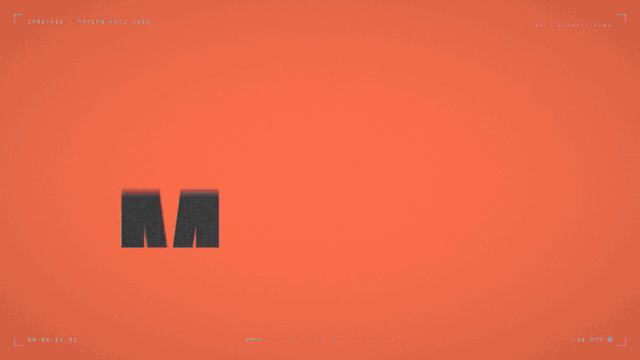
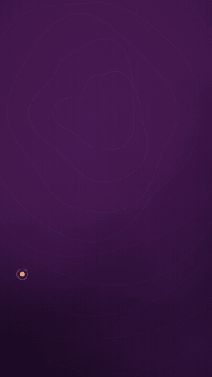
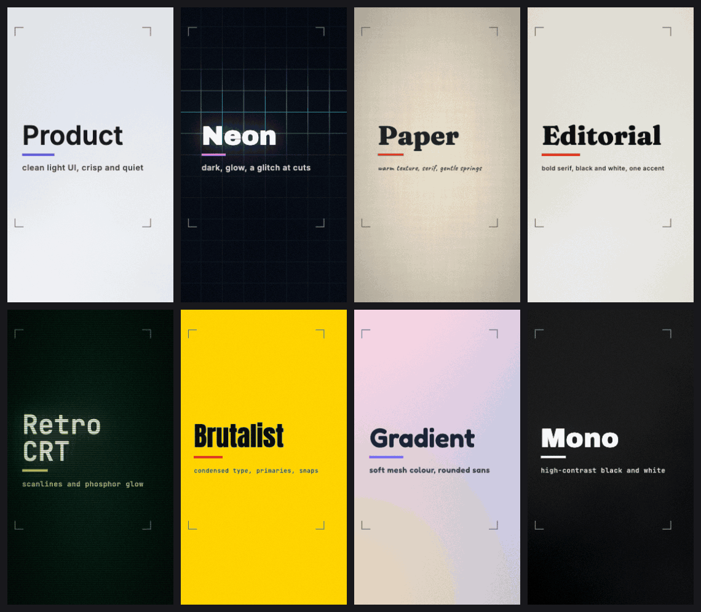

# sabotage-motion

Motion graphics for short-form video, written in code by your coding agent.

A Claude Code skill. The agent writes a scene as a pure function of time, `frame(t)`, drawn with Canvas2D over an
optional WebGL2 pass (bloom, grain, shader backgrounds, real motion blur). Headless Chrome renders every frame
exactly and pipes it to ffmpeg. Sound effects are synthesized in code on the same timeline, so they land on the
frame. No React, no framework, no render service: Node, Chrome and ffmpeg.



- **Storyboard.** One `board.js` per piece: each beat's voice line, on-screen copy, visual note and sound cue. A
  board sheet shows a panel per beat, first as slates and then as real frames, and a slate scene gives you an
  animatic with the real voice before anything is animated.
- **Voice-driven timing.** Word or character timings from a TTS take or a transcript become cue points, so cuts
  land on the words. A hook-length check is optional.
- **Captions.** Word-by-word captions from the same timings.
- **Mix and master.** Voice, an optional music bed ducked under it, and the synthesized effects, mastered to
  -14 LUFS for social.
- **Footage.** Screen recordings and clips as frame sequences, so they stay frame-exact.
- **`check`.** Measured checks before you post: size, fps and frame count, loudness and true peak, stretches where
  nothing moves, an empty first frame, and text outside the platform's safe zones.
- **Transparent output.** ProRes 4444 or WebM with alpha, for overlays on other footage.
- **Code and terminals.** Code typed out with a seeded cadence, diffs that land line by line and terminal sessions
  (typed commands, a spinner, a progress bar) in generic window, browser and phone frames, highlighted in the look's
  colours with no dependency, with key ticks that follow the typing.
- **A launch video for a repo.** A scan of the project's files (name, pitch, install command, features, colours,
  fonts, logo) drafts its brand kit, a full-page screenshot or a scroll sequence pictures its app, and a recipe puts
  them on a board: hook, install, features, end card.

Version 0.1.0, the first release. macOS and Linux; it needs Node 22 or 24, Google Chrome and ffmpeg
([Requirements](#requirements)). The design and its decisions are in [docs/PLAN.md](docs/PLAN.md).

## One prompt, three results

Three fresh Claude Code sessions, each on an empty home folder with only this skill installed (0.1.0), got the same
request:

> Make me a 5-second vertical (9:16) motion-graphics title card for a made-up travel app called Plumtrail, with the
> line "Plan trips in one tap". Build it in this folder, render the final mastered MP4, and run the quality check on
> that file. When you're done, tell me the final file's path and what the check said.

<p>



</p>

Each took about three minutes and handed back a mastered MP4 that `check --file` passed with 0 FAIL and 0 WARN.
All three read the name and went plum; the mark, the route and the type are each their own. The agent designs the
piece; the skill supplies the engine, the craft defaults and the checks. (The GIFs are silent; each master has
synthesized sound on its motion.)

## Install

Pick one route. Each was tested from GitHub on a fresh, empty home folder before this release.

**As a Claude Code plugin** (from this repo, which is also its marketplace):

```sh
claude plugin install sabotage-motion --marketplace sabotage-dev/sabotage-motion
```

That one-step form needs Claude Code 2.1.292 or later; inside a session, `/plugin install sabotage-motion
--marketplace sabotage-dev/sabotage-motion` works from 2.1.275. On older versions, add the marketplace first:

```sh
claude plugin marketplace add sabotage-dev/sabotage-motion
claude plugin install sabotage-motion@sabotage-motion
```

Third-party marketplaces do not update on their own: `claude plugin marketplace update sabotage-motion`, then
`claude plugin update sabotage-motion@sabotage-motion`.

**As a personal skill** (a plain copy, for every project on this machine):

```sh
git clone --depth 1 https://github.com/sabotage-dev/sabotage-motion
mkdir -p ~/.claude/skills
cp -R sabotage-motion/skills/sabotage-motion ~/.claude/skills/
```

For one project only, copy it into that project's `.claude/skills/` instead. To update, pull and copy again.

**With the skills CLI** ([skills.sh](https://skills.sh)):

```sh
npx skills add sabotage-dev/sabotage-motion -g -a claude-code
```

`-g` installs it for your user (`~/.claude/skills`); without it, into the current project. The CLI reports each
install to skills.sh anonymously; `DISABLE_TELEMETRY=1` turns that off.

Start a new Claude Code session after installing, so it loads the skill.

## Your first piece

**With Claude Code.** In an empty folder, ask for a piece in plain words, for example:

> Make a 6 second 9:16 end card for a made-up app called Plumtrail: a mark drawn in code, the name, the tagline
> "Maps that walk with you", a "Get the app" button, a whoosh and a chime, mastered for TikTok.

The skill copies its template into a piece folder, checks the machine with `doctor`, shows you a contact sheet
before the full render, then renders, masters and checks the file it hands you. For anything with a voice or more
than one beat it writes a storyboard first and shows you the board sheet.

**By hand.** From a clone of this repo:

```sh
cp -R sabotage-motion/skills/sabotage-motion/template my-piece
chmod -R u+w my-piece                         # cp keeps the source's modes
cd my-piece
npm install                                   # playwright-core; it drives your installed Chrome
node render.mjs doctor                        # Chrome, WebGL2, ffmpeg, fonts: says what to install if anything is missing
node render.mjs contact                       # contact.png: 12 frames of the whole timeline
node render.mjs full --out out/my-piece.mp4   # the video, and its effects as out/my-piece.wav
node tools/mix.mjs my-piece --master-only     # out/my-piece-final.mp4, mastered to -14 LUFS
node render.mjs check --file out/my-piece-final.mp4   # measured checks on the source and the master: 0 FAIL, 0 WARN
```

The template is a 3 s, 1080x1920 kinetic title card. `--param "title=Hello there"` (and `sub`; `look`, one of the
eight looks below; the colour tokens `bgA`, `bgB`, `ink`, `muted`, `accent` and `accent2` as `#hex`; and `bg`, the
background shader id: `none`, `gradient`, `paper`, `grid`, `crt` or `mesh`, never a colour) changes it without code
(new in 0.2: the `paper` shader takes its colour from `bgA`, and 0.1's `paper` colour param is gone; `look=paper` gives
the warm paper with its fonts);
`check` then warns that the board's copy is not on screen until `board.js` says the same. Change the piece itself in `scene.js` (the picture), `board.js` (the beats) and `audio.js` (the effects);
[SKILL.md](skills/sabotage-motion/SKILL.md) is the full workflow, and its `references/` go deeper.

## Looks and brand kits



A piece starts from a look on purpose, not from the same palette every time. Eight looks ship in `looks.js`:
`product`, `neon`, `paper`, `editorial`, `retro-crt`, `brutalist`, `gradient` and `mono`. Each sets the colour tokens,
the display, body and mono faces, the background shader, the post settings, the motion vocabulary (entrance, stagger,
whether a light sweep or a glitch is allowed, hard cuts or whips) and the timbre of the synthesized sound.
`--param look=paper` tries one; `CFG.LOOK = 'paper'` in the scene keeps it. The serif, condensed, rounded and hand
faces some looks use live once in `skills/sabotage-motion/looks/fonts/` (SIL OFL, 104 KB together) and are copied
into a piece only when its look uses them. The sheet above is made by `scripts/looks-sheet.mjs`, and each card in it
passes `check` with no FAIL and no WARN.

A brand kit is a `brand.json` in your project root: the colour tokens, a family and file per font role, the logo for
dark and light grounds, and an optional base look. Each piece keeps a copy with the files it names.

```json
{ "name": "Fernway", "look": "paper",
  "colors": { "bgA": "#0F2A2E", "bgB": "#173A3F", "ink": "#F4EFE3", "accent": "#F2A93B" },
  "fonts": { "display": { "family": "Fernway Display", "file": "fonts/fernway-display.woff2" } },
  "logo": { "onDark": "logo/fernway-on-dark.svg", "onLight": "logo/fernway-on-light.svg" } }
```

`--param` wins over the kit, the kit over the look, the look over the template. `node render.mjs doctor` checks that
every file the kit names exists and every colour parses; `node render.mjs brand` renders a brand sheet (swatches, a
type specimen, the logo on each ground) to approve before anything is animated; `node render.mjs palette` measures
whether a piece is in the kit's colours (each pixel of the check probe goes to its nearest colour by CIEDE2000 among
the kit's and every look's; the kit's background must take 15% and its accent 0.5%, and no look more). The render
record lists the resolved tokens and `fonts_used`, the families the scene actually drew with.
[references/looks.md](skills/sabotage-motion/references/looks.md) has the details.

## Storyboard and voice

Each piece has a `board.js`: its beats in order, each with a voice line (`vo`) or a length (`dur`), the
on-screen copy, a visual note and a sound note. The scene builds its timeline from it (`beatWindow(id)`,
`beatAt(t)`, `CFG.DUR = boardDur()` in `lib.js`), so the board is the one place timing lives. Run these in the
piece's folder:

```sh
node render.mjs board --slates              # board.png and board.md: a placeholder card per beat, estimated timing
node tools/voice-elevenlabs.mjs --model eleven_v4   # optional: voice the board in one take (take-raw.wav, take.json)
node tools/cues.mjs                         # cues.js, cues.json and vo.wav from take.json and take-raw.wav
node tools/cues.mjs --from whisper read.json --audio read.wav   # or: a human read, transcribed with openai-whisper
node render.mjs video --scene slate.js --out out/animatic.mp4   # the animatic's picture, timed by the take
node render.mjs board                       # the board sheet again, with the real scene and the take's timing
```

- **Timing sources.** `tools/cues.mjs` reads ElevenLabs' with-timestamps response (`--from elevenlabs`),
  openai-whisper's JSON written with `--word_timestamps True` (`--from whisper`), or a generic
  `{ words: [{ text, start, end }] }` file (`--from words`, the default) that any other tool can produce.
- **Cues.** Each voiced beat is cued where its anchor phrase starts (by default the line's first four words).
  `cues.js` holds those cues in seconds into `vo.wav`, plus `VO_OFFSET`, the picture time where the voice starts;
  the board helpers and captions add it once, so a scene never does.
- **Silences.** `gapBefore: 0.6` on a beat opens that much silence before its anchor, at the quietest point of the
  pause, and is refused where the cut would split speech. Silent beats between voiced ones get the same amount of
  silence spliced into the voice, so the picture and the voice stay in step.
- **Delivery tags.** `[curious]`, `[short pause]`, `[chuckles]` and the like in a `vo` line go to the TTS as
  written, but are never words, anchors or captions. Their sound belongs to the line they are written in.
- **Hook gate.** With `hookMax: 4.0` on the board, `tools/cues.mjs` refuses a take whose hook line ends after
  4.0 s of picture time, and says by how much.
- **Refusals write nothing.** A missing anchor, a gap that would split speech, a late hook, an `--offset` that
  would put the voice over the leading silent beats, or two anchors too close together stop the tool before it
  writes a file, so a bad take never replaces a good `cues.js`.
- **Captions.** `captions(ctx, CUES.WORDS, t, { safe: target.safe })` draws word-by-word captions inside the
  safe area, one group of lines at a time, the spoken word popped in the accent colour, and returns their text
  boxes.
- **ElevenLabs.** `tools/voice-elevenlabs.mjs` reads `ELEVENLABS_API_KEY` and `ELEVENLABS_VOICE_ID` from the
  environment or `--env-file`, sends no voice settings unless you pass `--voice-settings`, writes the audio
  before anything else so a later error never wastes the credits, and prints the character cost. It has no
  default model: the current one that reads delivery tags is `eleven_v4` (ElevenLabs' docs, checked
  2026-11-13).

## Mix, master and footage

`tools/mix.mjs` puts the sound under a rendered picture and masters it for social. Run it in the piece's
folder after `node render.mjs full --out out/<name>.mp4` (which also writes the effects as `out/<name>.wav`):

```sh
node tools/mix.mjs piece                             # voice (vo.wav), bed.mp3 if there is one, effects: -14 LUFS
node tools/mix.mjs piece --bed music.mp3 --bed-skip 1.2 --bed-at cue:save --mute 6.0-7.5
node tools/mix.mjs animatic --no-bed --no-sfx        # the animatic: the slate picture and the voice alone
node tools/mix.mjs sting --sting                     # effects only, -20 LUFS, for a clip cut into another video
```

- **What it writes.** `out/<name>-final.mp4`: the picture copied untouched, the mix as AAC 256 kb/s, 48 kHz,
  `+faststart`. `out/<name>.master.json`: the mode, the loudness target, the voice delay it applied, a hash of
  every input and of the render record it read, and the master's own hashes, so `check --file` can tie the
  master to the render it came from. A refusal writes nothing and leaves the last master as it was.
- **Voice.** Measured (EBU R128) and levelled to -24 LUFS, then `--vo-gain` (3.2), and delayed by `VO_OFFSET`
  from `cues.json`. A take quieter than -50 LUFS stops the mix.
- **Bed.** `--bed-gain` (0.22); `--bed-skip` seconds cut from its start; by default it starts so its end lands on
  the last frame (at 0 when it is longer than the picture), or at `--bed-at` seconds or `cue:<beat id>`. It fades
  out where it stops (0.35 s, or 2.6 s when it is longer than the picture), is silent over each `--mute a-b`
  window (picture time, with a short ramp outside it), and ducks under the voice.
- **Effects and other stems.** `out/<name>.wav` at `--sfx-gain` (0.9), and any `--stem file:gain:delay`, such as a
  clip's own sound.
- **Modes.** Default: -14 LUFS, -2.0 dBTP. `--master-only` masters the effects alone at the same target;
  `--sting` at -20 LUFS, -3.0 dBTP. `--target-lufs` and `--tp` override. The stems are summed, limited at
  -6 dBFS, then normalized in two `loudnorm` passes.
- **Comparing mixers.** `--keep-premix` keeps the mix before normalization as `out/<name>.premix.wav`, and
  `node scripts/parity.mjs <premixA> <premixB> <masterA> <masterB>` (from this repo) compares two: their 100 ms
  levels, their lengths, and the masters' loudness and true peak. It also measures the lag between the premixes
  (within 20 ms), which must be the one you state with `--lag <ms>` (default 0). State a latency only when you
  know its cause: a limiter whose lookahead is not compensated delays its mixer's whole output by the lookahead.
  B is shifted by the stated lag before the levels are compared, so a lag nobody stated (the voice alone a few
  milliseconds late, say) misses instead of being lined up.

`tools/frames.mjs` turns a clip or screen recording into a frame sequence the scene draws frame-exact:

```sh
node tools/frames.mjs demo capture.mov --from 12.5 --dur 4 --vf "crop=1080:1080:420:0,scale=540:540"
```

It writes `assets/seq/demo/000.jpg ...` at the piece's frame rate (`round(dur x fps)` frames) and records the
sequence in `assets/seq/manifest.json`. In the scene, `await loadSeq('demo')` in `init`, then
`ctx.drawImage(seqAt('demo', t, 2.0), x, y, w, h)` draws the frame for `t` with the clip starting at 2.0 s:
the first frame before that, the last frame held at the end, or `seqAt('demo', t, 2.0, { loop: true })` to loop.
Every frame stays decoded in memory (width x height x 4 bytes), so crop and scale with `--vf` to the size the
scene draws; `frames.mjs` prints the total and warns over 1 GB. Measured on an Apple-silicon Mac with 48 GB
(Chrome 157, 2026-11-14), Chrome's memory grows by about that total: a 20 s sequence at 30 fps, 960x540
(1.16 GB decoded), added 1.24 GB and decoded in 0.5 s; at 960x1706 (3.66 GB decoded) it added 3.6 GB and decoded
in 1.2 s. Both rendered. The limit is the machine's free memory, so keep a sequence well under it, and smaller on
CI runners. The clip's sound goes in through `mix.mjs --stem` (the tool's header shows the ffmpeg line).

## A launch video for a repo

`tools/repo-scan.mjs` reads a project and prints what a launch video is built from, each value with the file and line
it came from: the name, a one-line pitch, the install command, the features, the colours (CSS custom properties, a
Tailwind theme, a web manifest's `theme_color`), the fonts, the logo candidates ranked, and screenshots. It skips
dependency and build folders, never runs the project's code and never touches the network; with `--brand` it writes a
draft `brand.json` to show the person first. `tools/shots.mjs` pictures a local HTML file or an app running on this
machine at a stated viewport:

```sh
node tools/repo-scan.mjs ../.. --brand ../../brand.json      # the scan, and a draft kit in the project root
node tools/shots.mjs page home ../../site/index.html --viewport 390x844 --dpr 2    # one full-page screenshot to pan
node tools/shots.mjs seq feed http://localhost:5173/ --viewport 390x844 --dpr 2 --dur 3 --scroll 0:1400
```

A page that does not move is one full-page screenshot, which the scene pans. A page that moves becomes a frame sequence
in the layout `tools/frames.mjs` writes, at the piece's fps, the scroll and the page's own clock set for every frame; one
over 1 GB decoded is refused. [references/launch.md](skills/sabotage-motion/references/launch.md) is the recipe, and the
`repo-launch` example runs it on a made-up project.

## Caption a clip

A clip with speech (a talking head, a screen recording with narration) comes back with word-by-word captions inside the
platform's safe area, its sound levelled and mastered to -14 LUFS, and checked like any other piece. The clip is never
redrawn through the browser: the captions render with alpha on the clip's own clock, and ffmpeg lays them over it.

```sh
node tools/clip.mjs prepare talk.mp4 --board                         # the clip, its clock, vo.wav (its sound on that clock)
node tools/clip.mjs cues --transcript talk.srt                       # the transcript's words on the clip's clock
node render.mjs video --scene caption.js --alpha --out out/talk.mov  # the captions (--param style=pop|karaoke|boxed|minimal)
node tools/clip.mjs composite talk                                   # laid over the clip: out/talk.mp4 and its record
node tools/mix.mjs talk --no-sfx                                     # the clip's own sound, mastered
node render.mjs check --file out/talk-final.mp4
```

The transcript is whisper.cpp's JSON (`whisper-cli`, optional; `doctor` says whether it is installed), openai-whisper's
JSON, SRT or WebVTT. SRT and WebVTT give phrase times only, so their words are spread by length and marked estimated. A
variable-frame-rate clip is converted to the nearest standard constant rate first, a clip with non-square pixels to square
pixels at its display size, and `prepare` says so. A transcript made with whisper-cli comes from `out/vo16k.wav`, so it
is on the clip's clock; `--audio <n>` picks one of several audio tracks.
[references/delivery.md](skills/sabotage-motion/references/delivery.md) section 8 is the recipe, and the
`caption-clip` example runs it.

## Check and safe zones

`node render.mjs check` measures the piece before you post it, and `--file` measures the master too. Run it in
the piece's folder:

```sh
node render.mjs check                                    # the source: board, hook, copy, sound notes, motion, text
node render.mjs check --target tiktok                    # text against that platform's safe area (default: BOARD.target)
node render.mjs check --file out/piece-final.mp4         # plus the master that tools/mix.mjs wrote
node render.mjs check --file clip.mp4 --plain --lufs -14 --scale 0.5   # a file made elsewhere, as a plain file
node render.mjs contact --safe                           # the contact sheet with the safe area shaded (board --safe too)
```

It prints one line per result (`FAIL`, `WARN`, `ok`, or `skip` with the reason it could not run) and exits 1 on
any FAIL; `--strict` fails on a WARN too, `--json` prints the results as JSON, and `--only id,id` runs just those
checks.

| Check | Level | What it measures |
|---|---|---|
| `fonts` | FAIL | Every `CFG.FONTS` family loads. |
| `board_order` | FAIL | Beat windows are contiguous and in order, and `CFG.DUR` is `boardDur()` within a frame. |
| `hook_long` | FAIL | With `hookMax` on the board, the hook's last word ends by then (on a master, where its voice really starts). |
| `board_copy_missing` | WARN | A beat's on-screen copy (`on`) never appears in its window. |
| `board_copy_unread` | WARN | It appears for less than max(1.0 s, 0.25 s a word). |
| `board_sfx_missing` | WARN | A beat with a sound note has no 50 ms above -40 dBFS in its window (with `sfxHit`, no transient 12 dB over the 100 ms before it). |
| `motion_dead` | WARN | Nothing moves for 3 s or more outside a hold (a heuristic: a still frame repeats exactly with grain off). |
| `first_frame_empty` | WARN | The first frame is flat: a blank thumbnail. |
| `text_safe` | FAIL / WARN | Text outside the safe area for more than 0.25 s in a beat is a FAIL; less (a slam, a whip) is a WARN. Only a WARN while the target's zones are estimates. |
| `text_overlap` | WARN | Two pieces of text from different groups overlap by more than 2%. |
| `audio_spike` | WARN | The loudest 50 ms of the effects is more than 18 dB over the rest: a click. |
| `flash` | FAIL | More than three flashes a second over too large an area, per pixel, on the decoded picture: the current render in `out/`, or the `--file` itself. A safety net modelled on WCAG 2.3.1, not a certified photosensitivity test (`references/check.md` section 7). |
| `provenance` | FAIL | The file is the master `master.json` records, mixed from the render `render.json` records, and the piece's source has not changed since. Then the checks above replay that render's scene, params, fps and subframes. |
| `file_spec` | FAIL | Size, fps, pixel format, frame count `round(DUR x FPS)`, duration, and an audio stream. |
| `faststart` | WARN | In an .mp4, the index comes before the media, so playback starts before the download ends. |
| `loudness` | FAIL | Integrated loudness within 1 LU of the mix's target (or `--lufs`), true peak at or under -1.0 dBTP (or `--tp`). |
| `vo_delay` | FAIL | A voiced master's voice starts at `VO_OFFSET`. |

- **Text, without OCR.** The text checks read the scene's optional `boxes(t)`: one box per run of text, in design
  pixels before the camera, with a `group` for the words of one phrase and `deco: true` for decorative text.
  `check` samples it at every subframe time the render uses and maps each box through the camera that `frame(t)`
  returns, so text a camera move pushes out is caught, and so is text that leaves only between frames.
  `captions(..., { draw: false })` returns the caption boxes without drawing them. Without `boxes(t)`, those
  checks say they were not run.
- **Holds.** `export const HOLDS = [[t0, t1]]` in the scene, or `hold: true` on a board beat, marks a deliberate
  hold (an end card), which `motion_dead` leaves alone.
- **Safe zones.** `safezones.json` holds each target's safe rectangle, with a source, a measured date and an
  `estimate` flag for every edge, and optional `exclude` rectangles the app covers inside it. `tiktok-ad`,
  `reels-ad` and `shorts-ad` are the platforms' published zones for 9:16 ads, measured from their specs (TikTok's
  includes its button column as an `exclude`); they are stricter than organic posts. No platform publishes an organic
  zone, so `tiktok`, `reels` and `shorts` are researched estimates from published third-party measurements, cited in
  the file: `text_safe` only warns on them, and the overlays and `check` say "estimate".
- **Tuning.** `--dump out/check.json` writes the raw measurements (changed pixels per frame pair, the first frame,
  the audio windows, each result's level and numbers) with no on-screen text or params, for tuning the thresholds
  on real pieces. With `--plain` it holds each result's level and numbers alone.

## Examples

Six examples sit in `skills/sabotage-motion/examples/`, each a full piece runnable from its folder, with its
contact sheet and board sheet committed:

| Example | What it shows | `check` |
|---|---|---|
| `showreel/` | 20 s, 16:9, 60 fps: kinetic type, shape morphs, 22,000 particles, a raymarched blob, liquid metaballs, a data panel, a montage and an end card, with a synthesized score. It ends on the end card of sabotage development, the studio behind this repo. | 1 FAIL: `flash`, in four stretches (3.7-4.6, 6.3-8.9, 10.0-10.9 and 14.1-16.7 s), until P11b re-cuts it; 1 WARN kept on purpose (it fades up from black) |
| `explainer-beat/` | 16.7 s, 9:16: a three-beat explainer with a voice take from an openly licensed TTS voice (Kokoro-82M, Apache-2.0, `VOICE.md`), cues, captions, a synthesized bed, the mix | 0 FAIL, 0 WARN on the source and the master |
| `lower-third/` | 5 s, 16:9: a name strap rendered with alpha to ProRes 4444 and WebM, and composited over footage | 0 FAIL, 0 WARN (checked as an overlay) |
| `terminal-demo/` | 8 s, 9:16: a made-up command-line tool installed and run in a terminal (typed commands, a progress bar, a spinner), then its fix landing as a diff, with key ticks thinned to 12 a second, in the `neon` look | 0 FAIL, 0 WARN on the source and the master |
| `repo-launch/` | 15 s, 9:16: a launch video for a made-up project kept in the example: its scan, the brand kit the scan drafted, the install in a terminal, its code, a full-page screenshot of its app panned in a phone, and an end card | `palette` passes; 0 FAIL, 0 WARN on the source and the master |
| `caption-clip/` | 15 s, 9:16 at 540x960: a made-up screen recording (rendered by the engine, no person in it) with the explainer's voice as its sound, captioned word by word from its transcript: the captions rendered with alpha on the clip's clock, laid over the clip by ffmpeg, the clip's sound mastered | 0 FAIL, 0 WARN on the captions (as an overlay) and the master |

Each example's README has its commands. `ASSETS.md` lists every binary file in the repo with its source and licence.

## Requirements

- **Node** 22 or 24.
- **Google Chrome**, or any Chrome or Chromium binary in `CHROME_PATH`. Playwright's own Chromium works too
  (`npx playwright-core install chromium`, then set `CHROME_PATH` to its binary); CI checks it on both OSes.
- **ffmpeg** and ffprobe with the `libx264`, `libvpx-vp9` and `prores_ks` encoders and the `loudnorm`, `ebur128`,
  `sidechaincompress` and `alimiter` filters (`brew install ffmpeg` on macOS; the distribution's ffmpeg on
  Ubuntu has them).
- macOS or Linux. WebGL2 runs on the GPU through Metal on macOS, and in software (SwiftShader) on Linux.
- Optional: whisper.cpp's `whisper-cli`, to transcribe a clip for its captions (without it, bring a transcript).

`node render.mjs doctor`, run in a piece (or `npm run doctor` in this repo), checks all of it: it finds Chrome,
opens a WebGL2 context and prints the renderer, checks each ffmpeg encoder and filter, loads every font the piece
declares, and renders one frame twice to confirm the hashes match. Each failing line says what to install.

## Render speed

Milliseconds per frame for one second (30 frames) of the template's default scene at 1080×1920 with 8
motion-blur subframes (the scene doubles them during fast moves), measured with
`node render.mjs video --to 1` (2026-11-13; the CI numbers are six measurements over three runs, Node 22 and 24,
and vary a lot with the runner):

| Machine | WebGL2 renderer | ms per frame |
|---|---|---|
| GitHub Actions `ubuntu-latest` (x64), Chrome 156 | SwiftShader (software, through ANGLE on Vulkan) | 2684 to 5960, median about 3630 |
| GitHub Actions `macos-latest` (arm64), Chrome 156 | ANGLE on Metal (paravirtual GPU) | 387 to 798, median about 555 |
| Apple M5 Pro laptop, Chrome 157 | ANGLE on Metal | 234 to 259 |

Linux works but is slow at full size: 3 to 6 s per frame, so a 15 s piece at 30 fps (450 frames) takes 20 to 45
minutes.
Use `--scale 0.5` (or less) and fewer `--sub` for drafts there. A GPU-accelerated Linux recipe is planned for v2.

## Development

```sh
npm ci
npm test                                   # every suite
npm run test:engine                        # determinism, frame count and container, alpha, scene swap, board sheet
npm run test:voice                         # cues, board timing, the ElevenLabs tool against a local fake server
npm run test:mix                           # the mixer, control by control, and the parity script
npm run test:footage                       # frame sequences: the cut, the manifest, seqAt in a render
npm run test:check                         # check's detectors, fixture-check, the safe zones
npm run test:check-file                    # check --file on mixed masters
npm run test:flash                         # the flash check: the rule on frames built in code, dating, files
npm run test:looks                         # looks and brand kits: precedence, fonts, fonts_used, palette, brand sheet, look cards
node test/mutations.mjs [--fast]           # break each check detector and threshold on purpose: a test must fail
npm run test:code                          # code and terminal motion: token goldens, typing, scroll, boxes, key ticks
npm run test:launch                        # a launch video for a repo: the scan, page shots and sequences, the example
npm run test:clip                          # caption a clip: transcripts, the sync fixture through the whole path, the example
npm run test:energy                        # energy presets: the table, snapping, the rig, the template card at each preset, the bed stem
npm run test:examples                      # the examples: engine files, outputs, VOICE.md, cues, check
npm run test:repo                          # leak check, asset inventory, the skill text
```

The voice suites use synthetic takes only: hand-written timing files in each source's format
(`test/fixtures/takes/`) and tone or noise bursts for the audio. One live ElevenLabs smoke test calls the real
API and spends credits, so it is skipped unless you ask for it:
`SM_LIVE=elevenlabs SM_LIVE_MODEL=eleven_v4 ELEVENLABS_API_KEY=... ELEVENLABS_VOICE_ID=... node --test test/voice-live.test.mjs`.

The engine suites render `test/fixtures/fixture-clean` (a 2 s, 1080×1920 piece) and `test/fixtures/fixture-board`
(a five-beat board) at scale 0.25 in throwaway copies of the template under `test/.work/`. The mix suite renders
`test/fixtures/fixture-mix` (8 s, its effects a tick train) once and mixes synthetic stems under it: tone bursts
for a voice, seeded noise with an exact-zero marker for a bed. Each control is measured from the output audio
(sample positions and gains on the kept premix, loudness and true peak on the master). The footage suite cuts
ffmpeg-generated clips whose frames carry their own numbers, renders `test/fixtures/fixture-footage`, and reads
back which frame `seqAt` drew. The check suites render `test/fixtures/fixture-check` (19.2 s, voiced by a
synthetic take): one of each defect `check` looks for, between moving content, and the clean cases it must leave
alone (a held end card, grain, a 10 px dot moving 1 px a frame, a slow drift, word-by-word captions, a slam
entrance), then mix masters from it with each artifact defect. The code suites hold the highlighter to golden token
streams per language (`test/fixtures/code/`), check the typing, scrolling and boxes at stated times against values
worked out by hand, and render `test/fixtures/fixture-code` (typed code, a terminal and a phone frame on `tiktok-ad`)
for the frame hashes, `text_safe`, `text_overlap` and the key ticks in its sound. The launch suites scan made-up projects
built under `test/.work/` (colours from each source with their lines, the logo ranking, decoy dependency folders, a
guard that fails any network call), and capture `test/fixtures/fixture-shots/tall.html`, a tall page with landmarks at
known heights, as a full-page screenshot and as sequences read back frame by frame. `ASSETS.md` lists every binary file with its source
and licence, and a test keeps it complete.

**Leak check.** Nothing published here may contain an absolute home path or a string from the owner's denylist
(private names and ids). The denylist is never committed and is not stored on GitHub. It is a plain file on the
owner's machine, one string per line, matched case-insensitively: `~/.config/sabotage-motion/denylist.txt`, or the
file `SM_DENYLIST_FILE` names. The owner's clone runs `npm run hooks` once, which writes a pre-push hook into the
clone's own `.git/hooks` (not the working tree, so it keeps running on every checkout, and it blocks a push from a
checkout that has no `scripts/leak.mjs`, such as a branch from before the check existed). Before each push it runs
`scripts/leak.mjs`, which checks everything the push would publish that the remote does not already have (it asks the
remote with `git ls-remote`): each commit's message, author and committer, the paths new in it (merges included) and
the lines it adds; every tag object in a pushed tag's chain; the branch and tag names. It blocks the push on a hit,
and when it finds no denylist. `node scripts/leak.mjs history` checks every commit, tag and ref name in the clone. CI
checks home paths in every tracked file and tests the hook against throwaway repos. Hits are reported by entry
number, never by the entry's text; a path or ref name prints with the entry replaced by `[#N]`.

## License

MIT, copyright Sabotage Development LLC. See [LICENSE](LICENSE).
